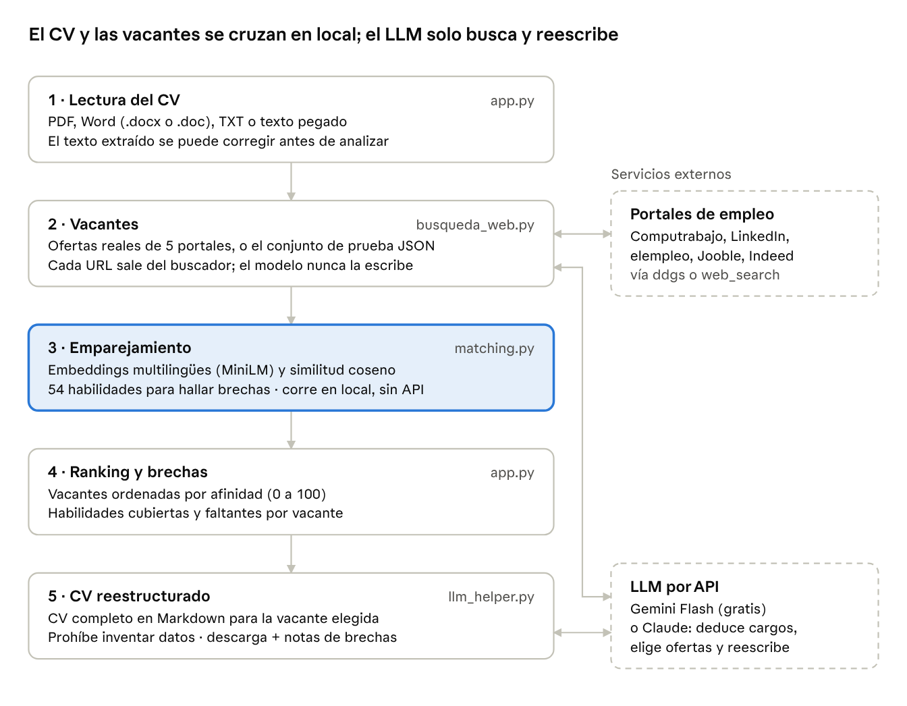
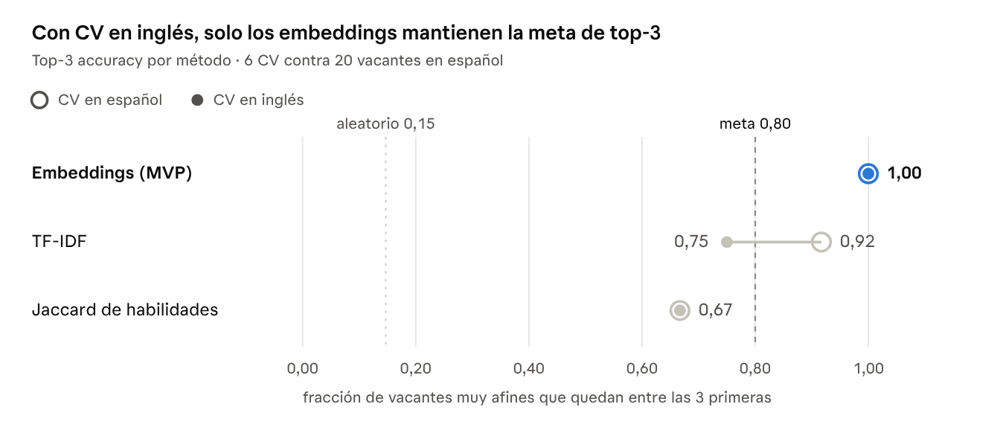

# Optimizador de CV con IA (PTIA – Hito 3)

Ordena vacantes **reales** por afinidad con tu hoja de vida, muestra qué habilidades te faltan y
reescribe el CV para la vacante elegida, sin inventar experiencia.

📄 **Documento del hito (diseño, implementación y validación):** [`docs/hito3.md`](docs/hito3.md)

## Ejecutar

    python3 -m venv .venv && .venv/bin/pip install -r requirements.txt
    .venv/bin/streamlit run app.py        # abre http://localhost:8501

La clave de IA se pega en la barra lateral de la app (botón "Recordar clave en este equipo" para
guardarla en `.env`, que no se sube a git). También se puede exportar antes de ejecutar:

    export GEMINI_API_KEY=tu_clave        # gratis en aistudio.google.com/apikey (Windows: set GEMINI_API_KEY=...)
    export ANTHROPIC_API_KEY=tu_clave     # opcional, con saldo en Anthropic

Sin clave funciona el modo **"Conjunto de prueba"** con `vacantes_ejemplo.json`.

## Flujo

CV (PDF, Word .docx/.doc, TXT o texto pegado) → búsqueda de vacantes reales → ranking por afinidad
→ brechas de habilidades → CV reestructurado para la vacante elegida (descargable).

| Archivo | Qué hace |
| --- | --- |
| `app.py` | Interfaz Streamlit y flujo completo |
| `matching.py` | Embeddings (`paraphrase-multilingual-MiniLM-L12-v2`), similitud coseno, habilidades y brechas. Corre en local |
| `busqueda_web.py` | Búsqueda de ofertas en portales de empleo (Computrabajo, LinkedIn, elempleo, Jooble, Indeed). Cada URL sale del buscador, nunca del modelo |
| `llm_helper.py` | Reestructuración del CV y sugerencias, sin inventar experiencia |
| `gemini_helper.py` | Acceso a Gemini: elige el modelo Flash disponible (cambiable con `GEMINI_MODEL`) |

### Motores de IA
Se eligen en la barra lateral:
- **Gemini (gratis):** la búsqueda usa `ddgs` (Google/Bing, sin clave) y Gemini solo elige y estructura las ofertas.
- **Claude:** usa la herramienta `web_search` y marca cada URL como verificada si salió de una búsqueda real.
  Modelo por defecto `claude-opus-5-5` (cambiable con `CLAUDE_MODEL`). La búsqueda web debe estar habilitada en la Console de Anthropic.

## Validación

    .venv/bin/python evaluacion/evaluacion.py          # ranking, habilidades y tiempos (sin API key)
    .venv/bin/python evaluacion/evaluacion.py --llm    # + CV reestructurado y búsqueda web (requiere clave)

Usa `evaluacion/dataset_eval.json` (6 CV en español e inglés × 20 vacantes, relevancia etiquetada a mano)
y compara el MVP con TF-IDF, Jaccard de habilidades y un orden aleatorio. Guarda `evaluacion/resultados.json`.

| Métrica | Resultado |
| --- | --- |
| Top-3 accuracy (meta ≥ 0,80) | **1,00** con CV en español y en inglés |
| MRR | 1,00 |
| TF-IDF con CV en inglés (comparación) | 0,75 de top-3 accuracy |
| Extracción de habilidades | precisión 1,00 · recall 0,71 |
| Ranking de 20 vacantes | ~71 ms (carga del modelo: 4,6 s) |

