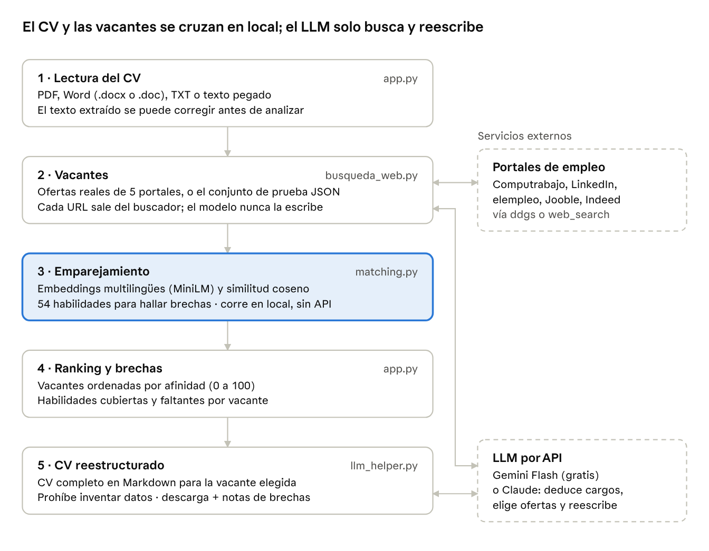
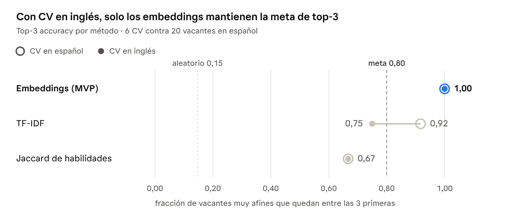

# Hito 3 · Optimizador de CV con IA: Solución y Evaluación

19 de noviembre de 2026

## Resumen

El Optimizador de CV con IA ordena vacantes reales por afinidad con una hoja de vida y luego la reescribe para la vacante elegida. Logra un **top-3 accuracy de 1,00** frente a la meta de 0,80, en 6 CV contra 20 vacantes etiquetadas.

El problema es que quien busca empleo envía el mismo CV a todas partes, sin saber a qué vacantes se ajusta ni qué le falta. El MVP resuelve eso en un solo flujo: lee el CV, busca ofertas en portales de empleo, las ordena con embeddings multilingües, muestra las habilidades que faltan y genera un CV adaptado sin inventar experiencia.

En la validación, los embeddings igualan a TF-IDF con CV en español y lo superan con CV en inglés (1,00 frente a 0,75). Con IA, el CV reescrito pasó de cubrir 16 a 25 de las 25 habilidades pedidas, sin inventar empleos ni fechas, aunque en 1 de 6 CV agregó 2 habilidades sin respaldo. Las debilidades principales son la extracción de habilidades (recall 0,71) y la búsqueda gratuita, que volvió vacía en 3 de 6 intentos.

## Diseño

La solución es un flujo de 5 pasos. El paso central, el emparejamiento, corre en local con un modelo de embeddings. El LLM se usa solo en los dos pasos que necesitan lenguaje: buscar vacantes y reescribir el CV.



El texto del CV entra al paso 2, para deducir qué cargos buscar, y al paso 3, para compararlo con cada vacante. Las flechas dobles son llamadas por internet que van y vuelven.

**Decisiones de diseño:**

| Decisión | Por qué |
| --- | --- |
| Emparejamiento con embeddings en local, no con un LLM | Es determinista, gratis y tarda menos de 0,1 s. El mismo CV da siempre el mismo ranking, y eso se puede evaluar. |
| Modelo multilingüe (`paraphrase-multilingual-MiniLM-L12-v2`) | Las ofertas en Colombia mezclan español e inglés. La validación muestra que aguanta CV en inglés. |
| Vocabulario controlado de habilidades, no extracción con LLM | Las brechas son explicables y no varían entre ejecuciones. A cambio, se escapan sinónimos (ver Resultados). |
| La URL de cada vacante sale del buscador, nunca del modelo | Evita vacantes y enlaces inventados. Con Claude, cada URL se cruza con los resultados reales de búsqueda. |
| Prompt de reestructuración con prohibiciones explícitas | El CV no puede ganar empleos, cifras ni habilidades que el original no respalde. Las brechas van en notas, fuera del CV. |
| Dos motores (Gemini gratis o Claude) | Cualquiera puede usar el MVP sin pagar. Claude da búsqueda web integrada cuando hay saldo. |

## Implementación

El MVP está escrito en Python 3 (unas 1.130 líneas en 5 módulos) y se usa desde el navegador con Streamlit. El emparejamiento corre en local; solo la búsqueda web y la reescritura del CV llaman a un LLM.

| Módulo | Responsabilidad | Tecnología |
| --- | --- | --- |
| `app.py` | Interfaz: carga del CV, fuente de vacantes, ranking, brechas y descarga del CV adaptado | Streamlit, pypdf, python-docx |
| `matching.py` | Embeddings, similitud coseno, extracción de habilidades, brechas y ranking | sentence-transformers (`paraphrase-multilingual-MiniLM-L12-v2`), NumPy |
| `busqueda_web.py` | Búsqueda de vacantes reales en portales de empleo y verificación de cada URL | Claude `web_search` o `ddgs` (Google/Bing) + Gemini |
| `llm_helper.py` | Sugerencias de adaptación y CV reestructurado en Markdown, sin inventar experiencia | Claude (`claude-opus-5-5`) o Gemini Flash |
| `gemini_helper.py` | Elige el modelo Flash disponible, controla tiempos y cae a un modelo más liviano si falla | google-genai |

**Lectura del CV.** Acepta PDF, Word (.docx y .doc) y TXT, o texto pegado. El texto extraído se puede editar antes de analizar.

**Emparejamiento.** El CV y cada vacante (título + descripción) se convierten en vectores normalizados de 384 dimensiones. Por eso el producto punto equivale a la similitud coseno, que se usa como puntaje de 0 a 100.

**Habilidades y brechas.** Un vocabulario controlado de 54 habilidades técnicas y blandas, más 18 alias ES/EN (p. ej. *data analytics* → análisis de datos), se busca con límites de palabra y sin tildes. Brecha = habilidad que pide la vacante y no aparece en el CV.

**Búsqueda de vacantes reales.** Hay dos motores:

- **Gemini (gratis):** Gemini deduce 3 cargos a partir del CV. Se hacen búsquedas en paralelo (`site:` por portal: Computrabajo, LinkedIn, elempleo, Jooble, Indeed) con un tope de 50 s. Solo quedan URLs de ofertas individuales, y Gemini escoge entre ellas por índice. La URL nunca la escribe el modelo.
- **Claude:** usa la herramienta `web_search` y entrega las ofertas con un esquema estricto (`reportar_vacantes`). Cada URL se marca como verificada solo si apareció en un resultado real de búsqueda.

**Reestructuración del CV.** El prompt prohíbe inventar empleos, cargos, fechas, cifras, certificaciones o habilidades. Cuando falta una métrica pone `[agregar métrica]`. Las brechas van en unas "Notas para ti" al final, fuera del CV.

## Validación

La validación mide si el ranking pone las vacantes correctas arriba, frente a tres líneas base. El objetivo cuantitativo del proyecto es **top-3 accuracy ≥ 0,80**. Todo se reproduce con `evaluacion/evaluacion.py`, sin internet ni API key.

**Conjunto de evaluación** (`evaluacion/dataset_eval.json`):

- **20 vacantes** de 12 áreas: datos, desarrollo, infraestructura, QA, contabilidad, finanzas, diseño, marketing, ventas, salud, educación y administración.
- **6 CV** de perfiles distintos: datos, backend, contabilidad, diseño UX, infraestructura y marketing digital.
- **Etiquetas de relevancia** hechas a mano para cada par CV-vacante: 2 = muy afín, 1 = parcialmente afín, 0 = no afín. Cada CV tiene entre 1 y 2 vacantes muy afines.
- **Habilidades de referencia** por CV: las del vocabulario que una persona reconoce en el texto, aunque estén dichas con otras palabras.
- **Versión en inglés** de cada CV, para probar CVs en otro idioma contra vacantes en español.

**Métodos comparados:**

| Método | Cómo ordena las vacantes |
| --- | --- |
| Embeddings (MVP) | Similitud coseno entre embeddings multilingües del CV y de la vacante |
| TF-IDF | Similitud coseno entre vectores TF-IDF de palabras (sin tildes) |
| Jaccard de habilidades | Solapamiento entre las habilidades extraídas del CV y de la vacante |
| Aleatorio | Orden al azar, promedio de 2.000 repeticiones |

**Métricas** (promedio sobre los 6 CV):

- **Top-3 accuracy:** fracción de las vacantes muy afines que quedan entre las 3 primeras. Es la métrica objetivo (`matching.top_k_accuracy`).
- **P@3:** fracción de las 3 primeras que es al menos parcialmente afín.
- **NDCG@5:** calidad del orden de las 5 primeras, usando la relevancia graduada (0, 1, 2).
- **MRR:** 1 / posición de la primera vacante muy afín.
- **Extracción de habilidades:** precisión, recall y F1 contra las habilidades de referencia.
- **Tiempos:** carga del modelo y ranking de 20 vacantes, en un portátil macOS sin GPU.

La reestructuración del CV y la búsqueda web se miden con `evaluacion.py --llm`, que necesita clave de Gemini o de Claude. Se cuentan las habilidades de la vacante que aparecen en el CV antes y después, y se revisan a mano las habilidades nuevas para separar las respaldadas de las inventadas. En la búsqueda se cuentan las URLs que salen del buscador y las que responden al abrirlas.

## Resultados

El MVP cumple la meta: top-3 accuracy de **1,00** frente a 0,80 exigido. Todas las vacantes muy afines de los 6 CV quedaron entre las 3 primeras, con CV en español y en inglés.



*Fuente: `evaluacion/resultados.json` · 6 CV × 20 vacantes, corrida del 19-11-2026.*

Con CV en español, TF-IDF queda casi igual que los embeddings, porque CV y vacantes comparten palabras. Con CV en inglés, TF-IDF cae a 0,75 y los embeddings no se mueven. Esa robustez es la razón para usar un modelo multilingüe.

**Calidad del orden** (más alto es mejor):

| Método | P@3 ES | NDCG@5 ES | MRR ES | P@3 EN | NDCG@5 EN | MRR EN |
| --- | --- | --- | --- | --- | --- | --- |
| Embeddings (MVP) | 0,78 | 0,91 | **1,00** | 0,72 | **0,88** | **1,00** |
| TF-IDF | **0,89** | **0,92** | **1,00** | 0,72 | 0,67 | 0,65 |
| Jaccard de habilidades | 0,61 | 0,60 | 0,61 | 0,61 | 0,62 | 0,69 |
| Aleatorio | 0,19 | 0,19 | 0,22 | — | — | — |

Con el MVP, la primera vacante del ranking fue siempre una muy afín (MRR = 1,00 en ambos idiomas). El P@3 de 0,78 se debe a que en 2 de los 6 CV el tercer puesto lo ocupa una vacante no afín: en el CV backend sale *Ingeniero de Machine Learning* y en el de diseño UX, *Desarrollador Móvil*.

**Extracción de habilidades:** precisión **1,00**, recall **0,71**, F1 **0,83**. Nunca detectó una habilidad que no estuviera, pero se le escaparon 10 de 34 cuando estaban dichas con otras palabras:

| CV | Habilidades no detectadas | Texto del CV |
| --- | --- | --- |
| Backend | pruebas unitarias, testing, api rest, agile | "pruebas automatizadas con pytest", "APIs de pago", "sprints con Scrum" |
| Marketing | liderazgo, trabajo en equipo, comunicación | "he liderado campañas", "apoyado al equipo comercial" |
| Infraestructura | ci/cd, git | "integración continua", "GitLab" |
| Diseño UX | trabajo en equipo | "colaboro con desarrolladores" |

**Tiempos:** cargar el modelo de embeddings toma entre 4 y 5 s (una sola vez por sesión). Ordenar 20 vacantes toma entre 37 y 71 ms, según la corrida.

### Reestructuración del CV (con IA)

La IA no inventó empleos, fechas ni certificaciones en ningún CV. En 1 de los 6 sí agregó 2 habilidades sin respaldo. Se midió con Gemini Flash (plan gratuito), reescribiendo cada CV para su vacante n.º 1. Los CV generados están en `evaluacion/salidas_llm/` para revisarlos.

| Medida | Resultado |
| --- | --- |
| Habilidades pedidas por la vacante que aparecen en el CV | 16 de 25 antes → **25 de 25** después |
| Habilidades nuevas en el CV, revisadas a mano | 11: **8 respaldadas** por el original, 1 leve, **2 inventadas** |
| CV con alguna habilidad inventada | **1 de 6** (infraestructura: Azure y Docker) |
| Empleos, fechas o certificaciones inventadas | **0**: lo que falta queda como `[Nombre de la empresa]` o `[agregar métrica]` |
| Afinidad con la vacante (embeddings) | 0,71 → 0,66 en promedio; baja en los 6 CV |
| Tiempo por CV | 5,9 s en promedio |

La cobertura se cuenta en los 4 CV en que la vacante pide habilidades del vocabulario. En los CV de diseño UX y marketing, la vacante no pide ninguna.

- **Respaldadas (8):** la IA nombró con la palabra de la vacante algo que el CV ya decía. Por ejemplo, "pytest" pasó a pruebas unitarias, Django y FastAPI a Python, "integración continua" a CI/CD, y "comunicadora social" a comunicación.
- **Leve (1):** el CV de datos dice en el perfil "motivado por aportar valor en la comunicación de datos". Es una intención, no una experiencia.
- **Inventadas (2):** el CV de infraestructura lista Azure y Docker en Habilidades. Sus propias notas reconocen que "solo cuentas con evidencia en AWS". Esto viola la regla del prompt de dejar las brechas fuera del CV.

La afinidad por embeddings bajó porque el CV nuevo es unas 7 veces más largo que el original. Las secciones de educación, idiomas y los espacios por completar diluyen el vector. Para medir si el CV mejoró sirve la cobertura de habilidades, no esta afinidad.

### Búsqueda web (con IA)

Las 17 vacantes encontradas tienen enlaces reales sacados del buscador. El problema es que la búsqueda gratuita no siempre responde: 3 de 6 búsquedas volvieron vacías.

| Medida | Resultado |
| --- | --- |
| Búsquedas con resultados | 3 de 6 |
| Vacantes encontradas | 17 (5 o 6 por búsqueda con resultados) |
| URLs que salieron del buscador | **17 de 17** |
| URLs que abren (HTTP 200) | 8 de 17 |
| URLs que bloquean el acceso automático (HTTP 429, 403, 401) | 9 de 17 |
| URLs caídas (HTTP 404) | 0 |
| Tiempo por búsqueda | 23 a 31 s |

LinkedIn (429), Computrabajo (403) e Indeed (401) rechazan las visitas automatizadas, así que esas 9 URLs no se pudieron confirmar ni descartar. Las 3 búsquedas vacías coincidieron con conexiones cortadas por el buscador gratuito. Repetida aparte, la del CV contable encontró 26 ofertas individuales.

## Discusión, limitaciones y trabajo futuro

El ranking por embeddings es confiable para poner primero la vacante correcta. Los puntos débiles están en lo que depende de terceros o de reglas fijas: el buscador gratuito, el vocabulario de habilidades y el cumplimiento del prompt por parte del LLM.

**Limitaciones:**

- **Conjunto pequeño.** Son 6 CV y 20 vacantes, etiquetados por el mismo equipo que hizo el sistema. Una diferencia de 0,11 en P@3 equivale a 2 vacantes, así que no es una diferencia estadística entre embeddings y TF-IDF en español.
- **Vocabulario de habilidades cerrado.** No cubre áreas como contabilidad (NIIF), diseño (Figma) o marketing (pauta). En esos CV las brechas salen casi vacías aunque el ranking acierte.
- **Habilidades por coincidencia exacta.** Se escaparon 10 de 34 habilidades por sinónimos ("pytest", "GitLab", "he liderado").
- **El prompt no basta para impedir invenciones.** Aunque lo prohíbe, Gemini puso Azure y Docker en un CV sin evidencia. Una regla en el prompt no garantiza su cumplimiento.
- **Búsqueda gratuita inestable.** El buscador sin clave corta conexiones cuando recibe muchas consultas seguidas, y 3 de 6 búsquedas volvieron vacías.
- **Resultados que cambian.** Las ofertas de los portales cambian cada día y el LLM no responde igual dos veces. Por eso la corrida con IA se guardó (`salidas_llm/`, `resultados.json`) y se puede recalcular con `--reusar` sin volver a llamar a la IA.

**Trabajo futuro:**

1. Revisar el CV generado antes de mostrarlo: si aparece una habilidad que no está en el original, quitarla o pasarla a las notas. La verificación de esta evaluación ya detecta esos casos.
2. Reintentar automáticamente la búsqueda cuando el buscador corta la conexión, con pausas entre consultas.
3. Agregar alias al vocabulario (pytest → pruebas unitarias, GitLab → git, integración continua → ci/cd) y volver a medir el recall.
4. Ampliar el conjunto a 30 o más CV reales anonimizados, etiquetados por 2 personas, y medir el acuerdo entre ellas.
5. Probar un puntaje híbrido (embeddings + TF-IDF) para mejorar el tercer puesto sin perder robustez en inglés.

## Conclusiones

- El MVP funciona de punta a punta: lee el CV, consigue vacantes, las ordena, muestra brechas y entrega un CV adaptado.
- El emparejamiento supera la meta del proyecto: top-3 accuracy de 1,00 frente a 0,80, y MRR de 1,00.
- Los embeddings multilingües son la elección correcta. Igualan a TF-IDF con CV en español y lo superan con CV en inglés (1,00 frente a 0,75).
- La reestructuración cumple su objetivo, porque cubre todas las habilidades pedidas, pero necesita una verificación después de generar. En 1 de 6 CV coló habilidades sin respaldo.
- Lo más urgente por mejorar es la detección de habilidades (recall 0,71) y la estabilidad de la búsqueda gratuita.

## Anexo: cómo ejecutar y fuentes

**Ejecutar el MVP:**

```bash
python3 -m venv .venv && .venv/bin/pip install -r requirements.txt
.venv/bin/streamlit run app.py          # abre http://localhost:8501
```

La clave de Gemini (gratis en aistudio.google.com/apikey) se pega en la barra lateral de la app. Sin clave funciona el modo "Conjunto de prueba".

**Reproducir la validación:**

```bash
.venv/bin/python evaluacion/evaluacion.py           # ranking, habilidades y tiempos
.venv/bin/python evaluacion/evaluacion.py --llm     # + CV reestructurado y búsqueda web (requiere clave)
```

**Fuentes del código y del diseño:**

| Archivo | Contenido |
| --- | --- |
| `app.py` | Interfaz Streamlit y flujo completo |
| `matching.py` | Embeddings, ranking, habilidades y brechas |
| `busqueda_web.py` | Búsqueda de vacantes reales y verificación de URLs |
| `llm_helper.py`, `gemini_helper.py` | Reestructuración del CV y acceso a los LLM |
| `evaluacion/dataset_eval.json` | 6 CV (español e inglés), 20 vacantes y etiquetas de relevancia |
| `evaluacion/evaluacion.py` | Script de validación y líneas base |
| `evaluacion/resultados.json` | Resultados de la corrida usada en este documento |
| `evaluacion/salidas_llm/` | Los 6 CV reestructurados por Gemini en esa corrida |
| `docs/img/` | Diagrama de arquitectura y gráfico de resultados |
| `cv_ejemplo.txt`, `vacantes_ejemplo.json` | Datos de demostración de la app |
